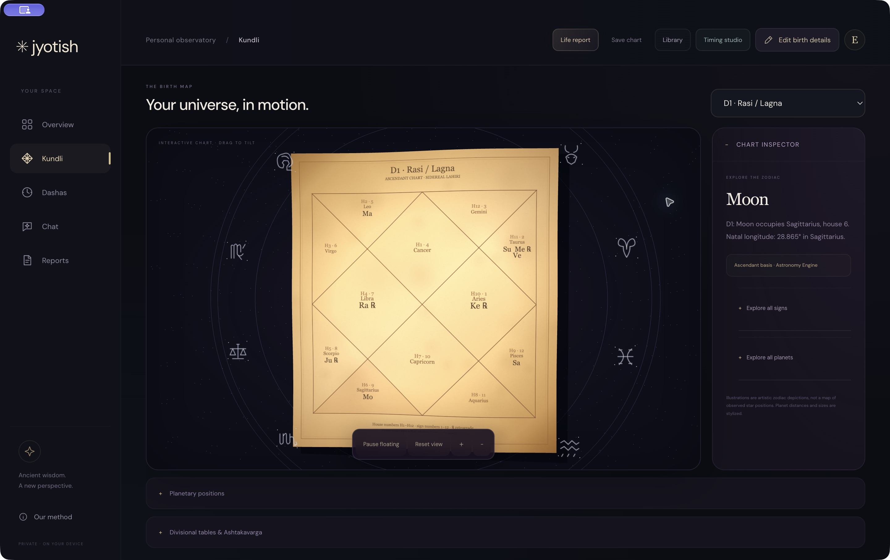

# Jyotish — Atlas Studio

A free-to-download desktop workspace for exploring Vedic birth charts, planetary periods, and personal readings with the reasoning visible. Jyotish preserves the original star logo and stores saved birth profiles, readings and life-report books locally.

**[Download Jyotish](https://www.rohaniyer.com/jyothish/)** · **[Releases](https://github.com/roronoa2003/jyothish/releases)**



## Installation

### Mac

1. Download the Apple Silicon ZIP for an M-series Mac, or the Intel ZIP for an Intel Mac. Check Apple menu → About This Mac if unsure.
2. Extract the ZIP and move **Jyotish.app** to Applications.
3. Open Jyotish. It includes its own Python runtime and PDF dependencies.

Requires macOS 13 or newer. Version 1.0.3 is an ad-hoc signed preview, **not Apple-notarized**. macOS may block first launch. Review the release/source and use macOS Privacy & Security's explicit approval flow only if you trust the build. Do not disable Gatekeeper globally. The Apple Silicon app was run and tested; Intel was packaged but not run on Intel hardware.

### Windows x64

1. Download the Windows x64 ZIP.
2. Extract the **entire folder**, keeping its supporting files together.
3. Open **Jyotish.exe** inside that folder. Create a shortcut if desired.

Targets Windows 10/11 x64. This portable preview is unsigned and may show a reputation warning. Windows execution has **not** been verified on Windows hardware; packaging and x64 executable checks were performed on macOS. Python installation is not required.

## Your first reading

Create a profile with birth date, local time and birthplace. Listed cities fill coordinates and historical time zones; other locations require an IANA time zone and coordinates. An explicit UTC offset is available for an ambiguous daylight-saving clock time.

Explore the floating parchment Kundli and select a house or planet. Change among sixteen divisional charts. Open **Timing studio** for daily or weekly readings through Mahadasha, Antardasha, Pratyantardasha, Sukshma and Prana. The combined reading explains natal/varga support and conflict, active house links and dated transit contacts. Expand supporting evidence or possible expressions as needed.

Choose **Save chart** for the local profile library. Multiple profiles, JSON backup import/export and reading history are supported. **Life report** runs the bundled Python generator and saves a PDF locally, with sixteen chart diagrams, twelve life-area chapters, dasha tables, twelve monthly analyses, personal antardasha narratives, conjunction chapters, seven Chara Karaka roles, a Sade Sati timeline, optional numerology, selected Lal Kitab practices and a method register. Reports have clickable contents and chapter bookmarks; length varies with chart and timing.

**Chat** uses the same combinational engine for supported topics. Optional Qwen Lite (0.5B) or Standard (1.5B) runs through WebLLM on compatible WebGPU hardware after an initial download. The app tests a short generation before marking it ready. This is a small local model, not ChatGPT; memory limits, unavailable WebGPU or cache eviction can prevent model loading. Computed offline readings remain available. A manual reading-pack export can be attached to your own ChatGPT conversation; the app does not automate a ChatGPT subscription or require an OpenAI API key.

## Local storage and privacy

The application has no profile sync, telemetry or external chart-calculation service. Charts, profile backups, book imports and PDF generation stay on the device. Optional model files download from public model/CDN hosts; birth data is not sent for inference. External source links open only on request.

Default desktop data directories:

- macOS: `~/Library/Application Support/Jyotish/`
- Windows: `%APPDATA%\Jyotish\`

Profiles are stored in `profiles.json`; readings in `readings/`; PDF inputs and generated books in `reports/`. Imported books and Qwen caches use the app's local Chromium storage. These files are **not encrypted by the app**. Export backups and PDFs to a location you control. Removing the app binary does not erase the library. Back up before clearing application data. An old Jyothish preview may have a separate data directory; export and import its profile library rather than deleting it.

## Method and source coverage

The engine combines computed evidence; it does not claim to have read, trained on or implemented every astrology book. Built-in source content consists of selected paraphrased rules and precise references. User-owned searchable PDF/text passages may be imported locally for retrieval, not model training.

| Source actually consulted | Implemented contribution | Coverage limit |
| --- | --- | --- |
| Brihat Parashara Hora Shastra, selected chapters 3, 6, 26, 46–51, 66; [linked English edition](https://vedic-astro.s3.amazonaws.com/books/bhrihat_parasara_hora_shastra.pdf) | Sign dignity, vargas, full sign aspects, Vimshottari proportional timing, conditional interpretation and received Ashtakavarga tables | Selected conventions; chapter numbering varies by edition. No full Shadbala or complete yoga/cancellation engine. |
| Phaladeepika, G. S. Kapoor translation/commentary, chapter 15 verse 30; [PDF page 154](https://jyotishvidya.com/HTMLobj-9415/Mantreswara_s__Phaladeeplka_.pdf#page=154) | Sign exchange, association, mutual aspects, relative kendra and trikona connections | Computes selected sign-based indicators. A connection is not a complete yoga or guaranteed result. |
| Saravali Volume I, R. Santhanam translation, chapter 4 verses 28–31 and 34; [PDF pages 49–51](https://s3-us-west-2.amazonaws.com/vedic-astro/books/saravali-vol-1.pdf#page=49) | Natural, temporary and fivefold planetary relations, separately in each direction; acknowledges missing strength components | Seven visible planets only; nodes excluded. Overall strength remains unresolved without full calculations. |
| [AstroSage Lal Kitab English e-book](https://www.astrosage.com/lalkitab/default.asp), selected planet/house pages | A curated set of optional house-based symbolic/conduct practices with match reasons and original placement links | Publisher adaptation, not a critical edition or full Lal Kitab engine. No Pakka ghar, debts, sleeping planets or annual Varshaphal. Uncovered placements are stated rather than invented. |

Lal Kitab selection remains separate from Parashari divisional strength. It matches the calculated D1 **whole-sign house** and highlights current lords as an app presentation rule. It does not infer a Lal Kitab benefic/malefic classification from Parashari dignity. Unsafe ingestion, dumping objects into rivers, wildlife feeding and expensive gemstone prescriptions are excluded. Practices are voluntary; their power to alter planetary outcomes is not established.

### Calculation conventions

Astronomy Engine 2.1.19 computes geocentric positions. The app uses an approximate Lahiri ayanamsa (23.8531° at J2000, advancing 50.29 arcseconds/year), an approximate sidereal ascendant, mean lunar nodes, whole-sign houses and full sign-based graha aspects. It is not Swiss Ephemeris or a claim of a “NASA algorithm.” Supported coordinates are 65°S to 65°N; missing coordinates use a Moon reference.

Vimshottari uses the remaining nakshatra fraction at birth, the 120-year cycle, 365.25636-day years and nested proportional subdivisions. Intervals are half-open: `[start, end)`. The final child endpoint is the exact parent endpoint. Daily and weekly boundaries and report timeline timestamps use UTC, explicitly labeled; they are not local sunrise-based days. Different year lengths and ephemeris conventions can shift boundaries.

D2 uses the Sun/Moon Hora convention; D30 uses unequal portions; D60 uses the declared degree-only mapping. High divisions are especially birth-time sensitive. There is no automated rectification. Base Ashtakavarga preserves the 337 SAV total; shodhana is not applied, and the selected Jupiter self-contribution variant is disclosed.

### Report depth and independent narratives

The life book now introduces each domain with a plain-language personal storyline before its technical evidence. Every displayed antardasha has chart-specific planetary relationship context and selected domain stories, rather than just date rows. Conjunction groups retain actual degree separation, and seven Chara Karaka roles use the declared degree-ranking convention. The report horizon is birth through 120 years, with the last displayed period truncated; it is not a lifespan prediction. A Sade Sati appendix computes sign phases around the natal Moon. Numerology remains a separate optional convention.

The generator was reviewed against a privately supplied long-form report for structure and explanation depth. Its text, personal data, dates and conclusions are not reused. This release does not replicate every feature of that report: full strength, all Raj yogas, cancellation rules, sunrise Panchang, gemstone/rudraksha prescriptions and event-probability tables remain outside the implemented coverage.

### How combined interpretation works

Each domain follows its natal house → lord → placement chains, significators, dispositor chains, planetary connections and relevant vargas. Comparisons retain reinforcing, conflicting and unresolved sign classifications. Timing uses actual subperiod durations, occupation/ownership links and sampled Jupiter/Saturn occupied-house/full-sign contacts. The report presents constructive, pressured and timing-dependent possibilities. Agreement counts and duration fractions describe computed coverage, **not probabilities of an event**.

Traditional astrology is not a scientifically validated event-forecasting method. Detailed calculations do not establish minute-level predictive accuracy or equivalence to an astrologer consultation. No medical diagnosis, lifespan, fertility verdict, guaranteed marriage or investment result is provided. Important decisions need real-world evidence. The app has no fear-based remedy upsells.

## Build from source

Build prerequisites: Node.js 22+ and Python 3.12+ with pip. Official Python runtime archives and PDF libraries are downloaded during the build. Runtime archive hashes and package versions are pinned in `desktop/runtime-lock.json`. End users do not need these build tools.

```sh
npm ci
npm run build
npm test
cd desktop
npm ci
python3 prepare-runtimes.py
npm test
npm run package
```

`desktop/package.mjs` produces Apple Silicon, Intel Mac and Windows x64 ZIPs in `artifacts/`. It bundles the web UI in Electron, plus architecture-specific CPython and ReportLab dependencies. Native signed/notarized distribution requires the maintainer's Apple/Windows signing credentials; these are not included.

A macOS build host is currently required for the complete three-target script because Mac signing/archive steps use `codesign` and `ditto`. The Windows package uses PE resource editing without Wine. `JYOTHISH_OUTPUT` can override artifact output; `JYOTHISH_TEST_DATA` selects an isolated development data directory. `JYOTHISH_WEB_SOURCE` can override the bundled UI source. Internal protocol/file identifiers retain the former `jyothish` spelling; displayed app name and icon are **Jyotish**.

The `docs/` directory is the download landing page served at `/jyothish/`. The application UI remains in `src/` and `dist/`; desktop packaging uses `dist/`. This is a separate repository and does not modify the portfolio repository.

## Validation

33 automated tests passed for this update. Checks cover historical time-zone conversion and ambiguous DST, eastern-horizon ascendant geometry, varga boundaries, Ashtakavarga totals, gapless dasha windows, five-level parent containment, proportional lengths and exact boundary switches, local profile persistence/import, protocol traversal protection, distinct interpretations for different synthetic birth profiles, support/conflict classification, duration coverage, sourced remedy selection and classical relationship directions.

Mac native checks verified chart calculation, local profile save/library, timing studio and bundled-Python life-report generation. PDF cover, charts, interpretation, daily reading and remedy pages were rendered and visually inspected. Windows and Intel runtime execution remain unverified.


## Interpretation engine update / 1.0.2

The source review for this release is recorded in [the research and rule register](RESEARCH.md). New interpretations are used by the timing studio, offline chat and Python life reports.

- Recompute house-ruler chains inside the selected varga, rather than using only its sign dignity.
- Add the antardasha position and ownership from the mahadasha lord as a temporary reference; keep each reference distinct from the natal ascendant.
- Preserve a debilitation condition in either chart even when the other sign is unclassified. Support and strain can coexist.
- Sample Jupiter and Saturn at six-hour intervals throughout a day, week or month, plus the final instant. Include full-sign aspects to relevant empty houses and contacts to the broader period lords active at each sample. Counts are observations, not durations or event probabilities; exact ingress times are not calculated.
- Treat a lord repeating at several dasha levels as one recurring influence. Distinguish direct house links from general significators and finer-period emphasis.
- Run a hypothetical ±5-minute ascendant experiment at 30-second steps. Flag changing divisional house chains as provisional. This is not birth-time rectification and does not test planetary or dasha stability.
- Read an explicitly requested month from its first UTC day, rather than starting halfway through it.

These changes improve consistency, specificity and traceability within the declared traditional framework. There is no measured increase in real-world predictive accuracy. Ephemeris conventions, full-strength calculations and the previously documented coverage limits remain material constraints.


## Verified Mac distribution / pending Apple enrollment

Current downloads remain non-notarized previews. The presence of a signing script does not mean Apple has accepted a build.

1. The maintainer must [enroll in the Apple Developer Program](https://developer.apple.com/programs/enroll/) and complete Apple's agreement, identity checks and payment. Apple lists US$99/year, with regional pricing at enrollment.
2. Create/install a **Developer ID Application** certificate with its matching private key in the build Mac's Keychain. A free development identity or an ad-hoc signature is insufficient.
3. Store notarization credentials securely with `xcrun notarytool store-credentials jyotish-notary` using its interactive prompts. Never commit credentials or paste them into chat.
4. Set `JYOTISH_SIGN_IDENTITY` to the exact Developer ID Application identity name and `JYOTISH_NOTARY_PROFILE` to `jyotish-notary`. Run `npm run notarize:check` in `desktop/`.
5. Build the previews with `npm run package`, then run `npm run notarize:mac`. The workflow signs separate copies with Hardened Runtime, submits each architecture, requires Accepted status, staples and validates the ticket, checks the signature and Gatekeeper, and creates separate notarized ZIPs.
6. Test launches, Python report generation and optional Qwen on the signed builds before publishing them and updating download links/checksums. Current preview files are not overwritten automatically.

The workflow was syntax-checked and correctly stops when no signing identity is present. End-to-end signing, Apple acceptance and hardened-runtime compatibility remain unverified until enrollment and credentials are available. Notarization addresses the unverified-developer warning; macOS may still show its ordinary first-launch download confirmation.

[Apple notarization documentation](https://developer.apple.com/documentation/security/notarizing-macos-software-before-distribution)


## Chat presentation update / 1.0.3

Personal chat replies now lead with a concise conditional outlook, the main opening or tension, and a practical next step. Full natal ruler chains, varga comparisons, dispositors and transit sampling remain in the expandable evidence panel. Asking why or requesting detail adds a short explanation to the reply. Technical chart questions retain their topic-specific answers. Optional local Qwen receives the same question-first presentation instructions; its factual validation remains in place.

This is a communication improvement, not a newly validated forecasting method. Source passages and rule calculations remain inspectable. The desktop app does not update automatically: download the new version, close the old app and replace it while retaining your local profile backups.
